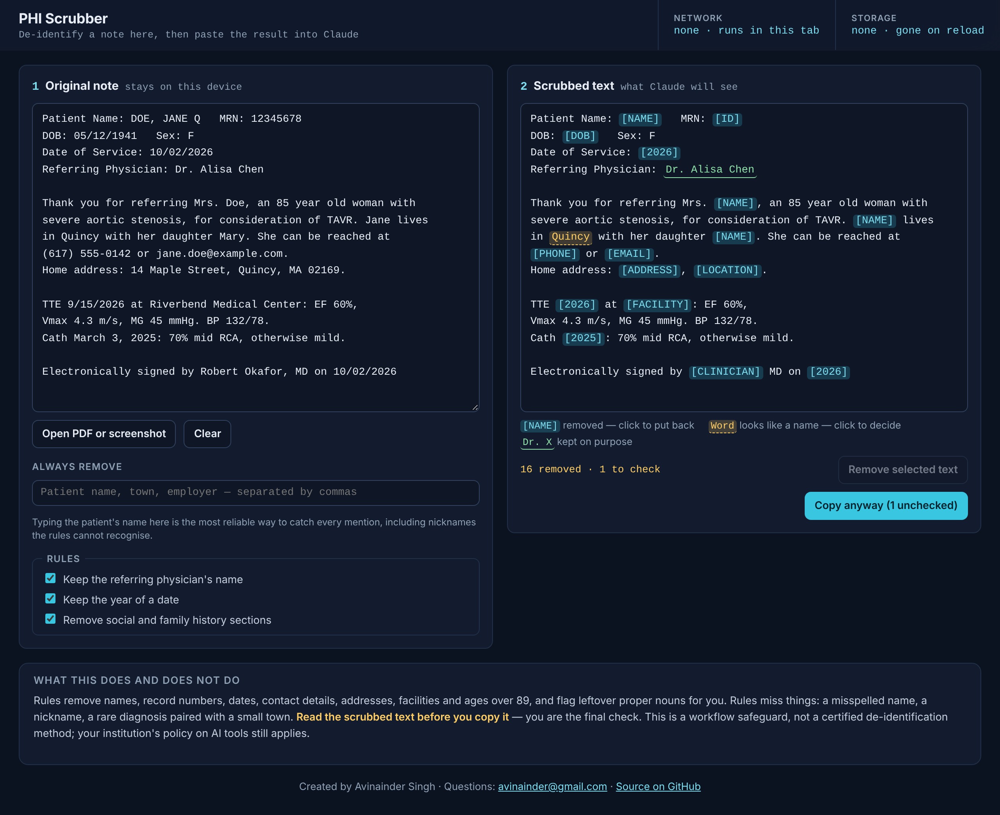

# PHI Scrubber

[](https://github.com/avinainder/PHIscrubber/actions/workflows/test.yml)
[](LICENSE)

De-identify a clinical note **in your browser** before pasting it into Claude,
ChatGPT or any other LLM. The original text never leaves the page; only the
scrubbed text is copied out.



*The note in the screenshot is invented.*

> [!IMPORTANT]
> PHI Scrubber is a workflow safeguard, not a certified de-identification
> method. It is neither a HIPAA Safe Harbor attestation nor an Expert
> Determination, and it is not a medical device. Pattern rules miss things.
> **The person reading the scrubbed text is the final check**, and your
> institution's policy on AI tools still applies.

## Contents

- [Why](#why)
- [Features](#features)
- [Quick start](#quick-start)
- [How to use it](#how-to-use-it)
- [What it removes](#what-it-removes)
- [Privacy model](#privacy-model)
- [Limitations](#limitations)
- [Host your own copy](#host-your-own-copy)
- [Use the rules as a library](#use-the-rules-as-a-library)
- [Prompt guard for Claude Code](#prompt-guard-for-claude-code)
- [Development](#development)
- [Contributing](#contributing)
- [Security](#security)
- [Credits](#credits)
- [License](#license)

## Why

Clinicians increasingly use LLM chat tools to summarise, draft and reason
about notes. Pasting a raw note sends names, record numbers, dates and
addresses to a third party. PHI Scrubber sits between the chart and the chat
window: paste the note, read what was removed, copy the scrubbed version.

## Features

- **Runs entirely on your device.** A static page with no backend, no
  analytics and no build step.
- **Typed placeholders** such as `[NAME]`, `[ID]` and `[2025]` keep the
  sentence readable for the model.
- **Human review built in.** Leftover capitalised words that look like a name
  or place are highlighted for you to remove or clear. Any removal can be put
  back with a click.
- **"Always remove" list** for the patient's name, town or employer, which
  catches nicknames and misspellings no rule can recognise.
- **PDF and screenshot intake.** Text is extracted from PDFs with pdf.js and
  from images with tesseract.js OCR, both vendored and run locally.
- **Fails closed.** Over-redaction costs a word; under-redaction leaks an
  identifier. When a rule is unsure, it removes or flags.
- **No dependencies to install.** The rules are plain ES modules with a test
  suite on Node's built-in test runner.

## Quick start

You need Python 3 to serve the page locally. Any static file server works.

```bash
git clone https://github.com/avinainder/PHIscrubber.git
```

```bash
cd PHIscrubber
```

```bash
python3 dev-server.py
```

Then open <http://localhost:8742>.

The page must be served over `http://localhost` or HTTPS. Opening
`index.html` directly from disk (`file://`) does not work, because browsers
block ES modules and web workers there.

## How to use it

1. Paste the note, or drop a PDF or a screenshot onto the page.
2. Type the patient's name under **Always remove**. This is the most reliable
   way to catch every mention.
3. Read the scrubbed pane.
   - Blue placeholders were removed. Click one to put the original back.
   - Amber words look like a missed name or place. Click to remove the word
     everywhere or mark it as not an identifier.
   - Green text was kept on purpose (the referring physician, by default).
   - Select any other text and press **Remove selected text**.
4. Press **Copy scrubbed text** and paste that into the LLM.

Three checkboxes adjust the rules: keep the referring physician's name, keep
the year of a date, and remove social and family history sections.

## What it removes

| Kind | Becomes |
| --- | --- |
| Patient and relative names | `[NAME]` |
| Clinician names (signed by, attending, PCP and similar) | `[CLINICIAN]` |
| MRN, accession, account, encounter, device serial and lot numbers, long digit runs | `[ID]` |
| Social Security numbers | `[SSN]` |
| Dates | the year only, for example `[2025]`; `[DATE]` when there is no year or the year implies an age over 89 |
| Date of birth | `[DOB]` |
| Phone, fax, email, URL | `[PHONE]`, `[EMAIL]`, `[URL]` |
| Street addresses, city/state/ZIP, "lives in …" | `[ADDRESS]`, `[LOCATION]` |
| Hospitals, clinics, practices | `[FACILITY]` |
| Occupation and employer | `[OCCUPATION]` |
| Ages 90 and over | `>89` |
| Social and family history sections | removed as a block (optional) |

The rules are written for English-language notes in United States formats
(dates, phone numbers, state abbreviations and ZIP codes). The built-in
clinical vocabulary that prevents false alarms leans toward cardiology.

## Privacy model

- **No network.** `index.html` carries a Content-Security-Policy that forbids
  any connection off the page's own origin. The browser enforces this, so it
  holds even if the code had a bug.
- **No storage.** Nothing is written to cookies, `localStorage` or IndexedDB.
  Reloading the tab discards everything.
- **No third-party code at runtime.** pdf.js and tesseract.js are committed
  under `vendor/` and load from the same origin. There is no CDN.
- **One exit.** The only way text leaves the page is the copy button, which
  copies the scrubbed text.

You can verify this yourself: open the browser's developer tools, watch the
Network tab while you paste a note, and confirm that no request is made after
the page has loaded.

## Limitations

- Rules miss things: a misspelled name, an unlabelled ALL-CAPS name, a
  nickname, a name split across a line break, or a rare diagnosis paired with
  a small town.
- OCR misreads letters. Check names carefully after dropping a screenshot.
- PDFs without a text layer (scanned pages) yield nothing. Screenshot the
  page and drop the image instead. Only the first 40 pages of a PDF are read.
- Removing direct identifiers does not make a note anonymous. A detailed
  history can identify a person on its own.
- Non-English notes and non-US formats are not covered.

## Host your own copy

The project is a folder of static files, so any static host works: GitHub
Pages, Vercel, Netlify, Cloudflare Pages, an internal web server or a shared
drive behind one. There is no build command and no output directory to set;
serve the repository root.

Scrubbing still happens in each visitor's browser. The host only delivers the
files and never sees a note. For a clinical team, hosting a copy on
infrastructure your organisation controls lets you pin a reviewed version.

## Use the rules as a library

`src/phiScrub.js` is a set of pure functions with no DOM and no I/O. It runs
in Node 22 or later and in any modern browser.

```js
import { scrub } from './src/phiScrub.js';

const { text, total, review } = scrub(note, {
  extraTerms: ['Jane Doe', 'Quincy'], // always remove these
  keepReferring: true,                // keep the referring physician's name
  keepYear: true,                     // reduce dates to their year
  dropSocial: true,                   // drop social and family history
});
```

| Export | Purpose |
| --- | --- |
| `scrub(text, opts)` | Returns the scrubbed text plus spans, learned names and a tally. |
| `findSpans(text, opts)` | Returns the spans to redact, keep or review, sorted and non-overlapping. |
| `applySpans(text, spans, restored)` | Builds the scrubbed text from spans. |
| `tally(spans, restored)` | Counts removals by type and spans still needing review. |
| `hardIdentifiers(text)` | Lists the kinds of high-confidence identifiers present. |

`review` is the number of spans a human still needs to judge. Do not treat
the output as safe to send while it is above zero.

## Prompt guard for Claude Code

`scripts/phi-guard.mjs` is an optional
[`UserPromptSubmit` hook](https://docs.claude.com/en/docs/claude-code/hooks)
that blocks a prompt carrying an MRN, date of birth, SSN or labelled patient
name. It is already wired up for this repository in `.claude/settings.json`.
To use it in another project, copy that hook entry and point it at the
script.

It only prevents transmission in Claude Code running on your own machine. In
cloud sessions and in web chat the text has already left your device before
any hook runs, so there the scrub page is the only protection. Set
`PHI_GUARD=off` to bypass it for synthetic fixtures.

## Development

Requires Node 22 or later. There is nothing to install.

```bash
npm test
```

| Path | Contents |
| --- | --- |
| `index.html`, `styles.css` | The page and its Content-Security-Policy |
| `src/phiScrub.js` | Scrubbing rules (pure functions) |
| `src/app.js` | Page controller |
| `src/pdfText.js`, `src/ocr.js` | PDF text extraction and screenshot OCR |
| `scripts/phi-guard.mjs` | Claude Code prompt guard |
| `test/` | Tests; every name and number in them is invented |
| `vendor/` | pdf.js and tesseract.js, committed as-is |

## Contributing

Contributions are welcome, especially new rules for identifiers the scrubber
misses. Read [CONTRIBUTING.md](CONTRIBUTING.md) first.

**Never put real patient information in an issue, pull request, test or
screenshot.** Reproduce the problem with an invented example of the same
shape.

## Security

To report a way that text can leave the page, or another vulnerability, see
[SECURITY.md](SECURITY.md).

## Credits

Created by Avinainder Singh. For questions, contact
<avinainder@gmail.com>.

## License

Released under the [MIT License](LICENSE). Vendored libraries keep their own
licences; see [THIRD_PARTY_NOTICES.md](THIRD_PARTY_NOTICES.md).
